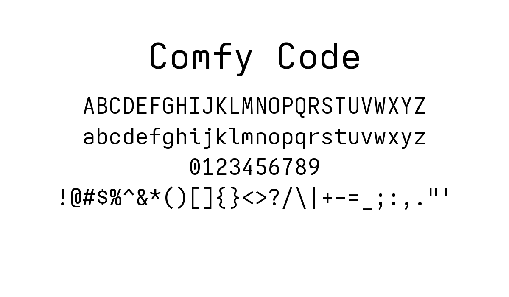
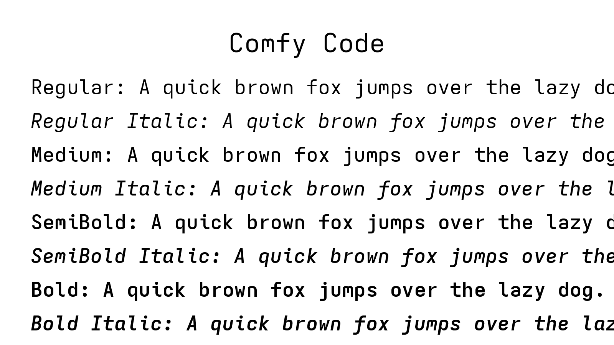

# Comfy Code

A custom build of [Iosevka](https://github.com/be5invis/Iosevka) for comfortable, distraction-free coding.

## Features

- Fixed-pitch, sans-serif letterforms
- Normal and Condensed widths
- Upright and italic styles
- Programming ligatures disabled

- Unhinted TTF package

## Specimen

A quick at-a-glance view of letterforms, numerals, and punctuation.

<p align="center">
  
</p>

## Weights & Italics

The preview highlights Light, Regular, Medium, and Bold in both roman and italic. Releases include the full set of generated weights.

<p align="center">
  
</p>

## Download & Install

Download the [latest release](https://github.com/zzhaolei/comfy-code/releases/latest):

- `ComfyCode-unhinted.zip` for unhinted TTF files

Extract the archive, then install the TTF files through your operating system.

## Build Locally with Docker

Run these commands from the repository root with Docker running. The image uses the unmodified source version in `IOSEVKA_VERSION` and installs the build tools. The first build downloads the source and dependencies; subsequent image builds reuse Docker's cache. Your build plan is mounted read-only and loaded on every run.

```bash
# Quick trial: Regular weight, both widths, upright and italic (4 unhinted TTFs).
docker compose run --build --rm fonts preview

# All configured weights, widths, and slopes as unhinted TTFs.
docker compose run --build --rm fonts unhinted

```

Preview fonts appear in `dist/docker/ComfyCodePreview/TTF-Unhinted/` and use the family name **Comfy Code Preview**, so you can install and compare them alongside Comfy Code. Full-family builds appear in `dist/docker/ComfyCode/`. On macOS, open the generated unhinted TTFs in Font Book to install them, then select the font in your editor.

The default is two concurrent jobs. To reduce memory usage, use `BUILD_JOBS=1 docker compose run --build --rm fonts preview`. Keep `--build` when changing `IOSEVKA_VERSION` or Docker build files so the image includes those changes.


## License

The repository configuration and automation are licensed under the [MIT License](LICENSE). Generated fonts are derivatives of Iosevka and remain licensed under the [SIL Open Font License 1.1](https://github.com/be5invis/Iosevka/blob/main/LICENSE.md).
